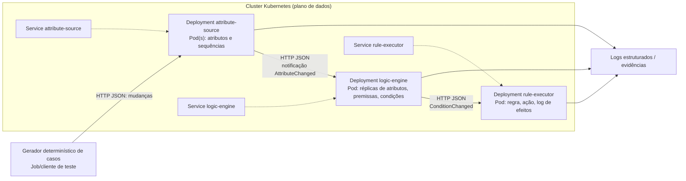

# TCC2 — Etapa 04: arquitetura distribuída proposta

**Situação:** especificação de projeto, não implementação comprovada.  
**Data:** 2026-11-11.  
**Base do código:** `JnetSilvestre/codigoPon`, branch `main`, commit `c2d525b5c675820806af34348e259bff32a6bc5f`.  
**Base da monografia:** commit `2eb080b93a38db47ea1149bb660a5379c6478bd4`.  
**Escopo:** objetivo geral e objetivos específicos aprovados no TCC1; demonstrar viabilidade técnica de distribuir uma prova de conceito PON em Kubernetes, sem obrigatoriedade de ganho de desempenho.

## 1. Evidências do código examinado

- `main.py`: exercício local de dois `Attribute`, comparações `Premise` e conjunção `Condition`; não demonstra comunicação interprocessos.
- `pon/Attribute.py`: alteração de valor dispara `update` apenas quando há mudança; `getEncoded()/handleEncoded()` serializam/recebem JSON com chave `v`; os metadados de ordenação não existem.
- `pon/Premise.py`: recebe notificações dos atributos, reavalia comparação e notifica dependentes quando o resultado muda.
- `pon/Condition.py`: agrega premissas e monitora alterações, porém usa `self.__id` fora da classe `Notifier` (campo privado não acessível por *name mangling*) e propaga via `element.update` sobre entradas, em vez de notificar os observadores da condição; demanda correção e teste.
- `pon/Rule.py`: associa condição a ação e usa `asyncio.create_task()`, que requer laço de eventos ativo; não há garantia de execução no teste de `main.py`.
- `pon/Action.py` e `pon/Instigation.py`: invocam métodos locais, sem execução remota.
- `pon/Notifier.py`: manutenção de observadores locais e identificação de entidades; IDs 0 não são registrados globalmente.
- `pon/NOPManager.py`: singleton, mapa de entidades e ganchos de driver `sendNotification`, `handleDriverNotification` e `run`; nenhum driver concreto foi encontrado no inventário da branch.
- Não foram encontrados Dockerfile, manifestos Kubernetes, testes automatizados, ou descrição de protocolo de comunicação. O repositório contém materiais bibliográficos e arquivos ZIP de referência, que não representam código automaticamente integrado ao pacote Python.

**Distinção científica:** esse código não equivale ao motor NOP Query da tese, ao framework C++ ou a uma aplicação completa de consulta a vídeos.

## 2. Decisão arquitetural recomendada

Usar **distribuição por fronteiras de processos da cadeia lógica**, não um Pod para cada entidade PON. A prova mínima terá três serviços Python, cada qual com processo e contêiner próprios:

1. **Produtor de atributos (attribute-source)**: controla um ou mais atributos, produz alterações determinísticas numeradas, registra o estado autoritativo dos atributos e envia notificações.
2. **Avaliador lógico (logic-engine)**: consome alterações, atualiza as réplicas de atributos necessárias, usa `Premise` e `Condition` do núcleo após correções verificadas, emite transições de condição e mantém seu estado lógico local.
3. **Executor de regras (rule-executor)**: consome transições aprovadas, decide disparos da regra, executa `Action/Instigation` (efeito observável simples, por exemplo escrever evento estruturado) e registra os IDs processados.

**Transporte mínimo recomendado:** HTTP interno sobre TCP com mensagens JSON e endpoints explícitos; menos componentes externos que Kafka/RabbitMQ e adequado à demonstração da fronteira de processos. O envio síncrono HTTP é apenas comunicação de borda; a avaliação interna permanece dirigida por notificações PON. Uma fila persistente fica como evolução futura, não requisito inicial. O produtor NÃO deve publicar eventos nulos/redundantes quando o atributo não muda.

**Importante:** os componentes acima não existem ainda como serviços completos no código; a proposta exige adaptação durante a Etapa 07.

### Diagrama lógico e de implantação proposta

Os Services fornecem descoberta de rede; Deployments gerenciam réplicas e recuperação operacional. Para a prova inicial, **1 réplica de cada serviço**, evitando divisão inconsistente de estado. Réplicas adicionais exigem estratégia de particionamento por chave e coordenação, a serem discutidas apenas após a prova mínima.

## 3. Contratos propostos (ainda não implementados)

- `POST /attributes/change` no produtor: payload `{"run_id":"r1","entity_id":"at1","value":10,"request_id":"req-1"}`. Rejeitar ID inválido ou tipo incompatível. Resposta inclui `sequence`, `changed` e `event_id`.
- `POST /notifications/attribute` no avaliador: `{"schema_version":1,"event_id":"r1:at1:1","run_id":"r1","source":"attribute-source","entity_id":"at1","sequence":1,"value":10,"emitted_at":"<UTC ISO 8601>"}`.
- `POST /notifications/condition` no executor: `{"schema_version":1,"event_id":"r1:cn1:1","run_id":"r1","source":"logic-engine","entity_id":"cn1","sequence":1,"approved":true,"caused_by":"r1:at1:1","emitted_at":"<UTC ISO 8601>"}`.
- `GET /health/live` e `GET /health/ready` em cada serviço; `GET /state` restrito ao ambiente de teste, para inspeção e evidência.

**Observação:** os campos são uma **proposta de contrato**, não uma descrição das atuais interfaces Python. `event_id` estável para repetição; `run_id` isola execuções experimentais; `entity_id` liga mensagem à entidade; `sequence` estabelece ordem por origem; `caused_by` permite rastrear causalidade. Validação de esquema e autenticação de serviços devem ser planejadas; não expor endpoints de mutação publicamente.

## 4. Fluxo proposto de notificações

1. Gerador aplica uma alteração de valor identificada por `run_id` e `request_id`.
2. Produtor compara valor anterior e novo; somente mudança real incrementa sequência e gera `AttributeChanged`.
3. Avaliador recebe evento, rejeita duplicatas, detecta eventos fora de ordem e aplica a atualização à réplica do atributo.
4. A mudança na réplica aciona a cadeia PON local: `Attribute → Premise → Condition`. Apenas a transição lógica relevante gera `ConditionChanged`.
5. Executor recebe transição, verifica versão/sequência e critério de disparo: uma transição para verdadeiro produz o efeito observável da regra; uma transição para falso atualiza estado, sem executar a ação.
6. Logs correlacionados permitem comparar sequência recebida, transição lógica e efeitos com o oráculo de referência executado em processo único.

**Hipótese operacional:** sem perda/falha e com ordem preservada por entidade, os resultados funcionais devem corresponder ao processamento local. Isso será testado, não presumido.

## 5. Estado, ordem, falhas e reinicialização

- **Dono do estado:** produtor é autoritativo para valores e sequências dos atributos; avaliador mantém cópias e estados de premissas/condições; executor mantém o último evento visto e histórico mínimo de efeitos da execução.
- **Entrega inicial:** HTTP com confirmação e retentativas limitadas causa possibilidade de entrega pelo menos uma vez durante retentativas, não exatamente uma vez. Deduplicar por `event_id` e controlar `sequence` por `run_id/entity_id`.
- **Sequenciamento:** um produtor lógico por entidade; atualizar estado e incremento de sequência atomicamente no processo. Eventos com lacuna ou ordem invertida devem bloquear a avaliação daquela entidade e sinalizar erro/necessidade de ressincronização, nunca aplicá-los silenciosamente.
- **Inicialização:** na partida do avaliador, instalar o snapshot dos valores de atributos e números de sequência antes de aceitar eventos. Registrar um identificador de versão do snapshot; sincronizar estado e mensagens subsequentes para não perder alterações durante a inicialização.
- **Falhas:** estado apenas em memória não sobrevive a reinício; para demonstrar recuperação correta, usar reexecução determinística de toda a rodada ou um mecanismo explícito de snapshot/replay a implementar e testar. Não alegar tolerância a falhas ou durabilidade antes disso.
- **Escala:** 1 réplica por papel no experimento mínimo. Para escalar logic-engine, particionar por `run_id` ou identificador de cadeia, preservando no mesmo detentor todos os atributos necessários à condição; requer roteamento estável e recuperação do estado. Não multiplicar réplicas com Service de balanceamento aleatório sobre estado independente.

## 6. Kubernetes planejado

- Namespace isolado `tcc2-pon`, `ConfigMap` para endereços e parâmetros não sensíveis, `Deployments` separados, `Services` internos tipo `ClusterIP`, probes de saúde, logs estruturados e requests/limits a determinar após levantamento do hardware na Etapa 06.
- O gerador pode executar como `Job` e enviar carga reproduzível, com semente e lista ordenada de alterações.
- Para demonstrar **distribuição física entre nós**, capturar `kubectl get pods -o wide` com IDs de nós distintos para ao menos produtor e avaliador; caso o cluster só tenha um nó, limitar a conclusão à distribuição entre processos/Pods.
- Não utilizar `PersistentVolume`, autoscaling, Kafka, banco de dados nem Ingress na prova mínima sem necessidade constatada.

## 7. Adaptações obrigatórias antes de implantar

1. Criar testes locais de cadeia `Attribute → Premise → Condition → Rule → Action` com saída determinística; evitar conjunção contraditória como único caso.
2. Corrigir e testar notificação e encapsulamento de `Condition`, além de compatibilizar agendamento de `Rule` com laço asyncio ativo.
3. Corrigir/definir o registro de IDs e a associação entre IDs numéricos internos e identificadores de rede; proteger contra colisão ou sobrescrita no `NOPManager`.
4. Implementar drivers ou adaptadores HTTP e validação de payloads; assegurar que replicação remota não crie ciclos/eco de mensagens.
5. Implementar deduplicação, ordenação, rastreamento causal e estado inicial coerente.
6. Criar testes de equivalência entre oráculo local e arquitetura em três processos ANTES de Docker/Kubernetes.
7. Documentar versões Python, dependências, comandos e casos de teste, sem simular execução.

## 8. Critérios de validação a especificar na Etapa 05

| ID | Evidência planejada | Critério proposto |
| --- | --- | --- |
| V01 | Testes unitários PON | Alteração efetiva notifica dependentes; alteração idêntica não produz nova transição |
| V02 | Oráculo local x três processos | Mesma sequência de efeitos para a mesma entrada determinística |
| V03 | Endpoints e protocolo | Campos e tipos validados; erros inválidos rejeitados com resposta explícita |
| V04 | Transporte | Entrega observável entre PIDs/contêineres distintos e IDs de evento correlacionados |
| V05 | Duplicação | Reentrega do mesmo evento não duplica efeito |
| V06 | Ordenação | Lacunas e eventos atrasados são detectados e tratados sem corromper o estado |
| V07 | Estado inicial | Receptor inicializado com snapshot coerente antes da sequência incremental |
| V08 | Kubernetes | Deployments/Services saudáveis; comunicação interna comprovada |
| V09 | Distribuição física | Evidência de Pods em nós distintos, ou limitação de um só nó declarada |
| V10 | Reinício | Recuperação por replay ou reinício completo da rodada; perdas documentadas se sem persistência |
| V11 | Reprodutibilidade | Registro de SHA, versões, topologia, entradas, logs e comandos |
| V12 | Recursos (complementar) | CPU, RAM e latência somente se instrumentos e cenários permitirem, sem pressupor melhoria |

Não foram executados testes nesta Etapa 04. A Etapa 05 definirá protocolos, tamanhos de carga, repetições, critérios quantitativos e instrumentos de medição.

## 9. Riscos e limites

- Limites semânticos: uso de Python e HTTP não demonstra equivalência ao NOP Query C++.
- Complexidade de rede: duplicação, atraso e falhas parciais; sem camada de transporte não há distribuição.
- Estado: sem persistência, reinícios podem perder dados; política de recuperação deve ser explícita.
- Escalabilidade: mais réplicas não significam processamento repartido ou correto.
- Infraestrutura: cluster local multinó virtual difere de máquinas físicas independentes.
- Risco de agenda: primeira meta deve ser uma prova funcional verificável, não desempenho ou alta disponibilidade.

## 10. Encaminhamento

**Etapa 05 — Planejamento da metodologia e dos experimentos**: transformar V01–V12 em protocolo experimental reproduzível, definir entradas, oráculo de resultados, evidências, topologia de cluster e limites de execução; confirmar com o orientador a adoção da prova de conceito Python e a divisão em três processos.

**Versionamento:** `tcc2/desenvolvimento` é a branch de trabalho permanente da monografia; `master` fica preservada até revisão final. A branch anterior `tcc2/etapa-03-fundamentacao` permanece como marco histórico, já que o conector não oferece exclusão de ref e exclusão não é necessária para o fluxo.
